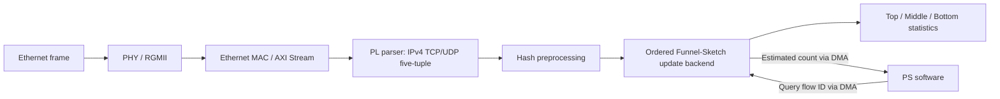

# System architecture (documentation release)

> Scope: technical overview of the F21C FPGA network-flow measurement prototype. This is not design source or a verified reconstruction package.

## Platform and data paths

- Target prototype: AC7021B with AMD/Xilinx Zynq-7020, using programmable logic (PL) and processing system (PS).
- Ethernet reception: RJ45/PHY through RGMII to the Ethernet MAC and a streaming receive path.
- Flow identification: an IPv4 TCP/UDP five-tuple (source/destination IP, source/destination port and protocol) is extracted from eligible frames.
- Measurement: a Funnel-Sketch-based hierarchical structure uses Top, Middle and Bottom state layers to track approximate per-flow packet frequencies. The design adapts an existing research method; this repository does not claim invention of the underlying Funnel-Sketch algorithm.
- Hardware task organization: parsing, hash preprocessing and the stateful statistics backend are organized as three stages, with FIFO decoupling. Updates, queries and resets share an ordered state-maintenance backend.
- Software control: the PS initializes and supervises the hardware, issues selected-flow queries, and reads statistics over DMA/AXI interfaces.

## Engineering interface notes

The project's historical records describe a 100 MHz main PL control clock, an Ethernet transmit clock domain, and PS-to-PL query/result channels. The frozen V3 tree includes the [block design, pin constraints and MAC configuration](../candidate-b/project/). DMA1 MM2S carries query keys from PS to HLS, and DMA0 S2MM returns query results to PS. A matching tool-generated platform is a build output.

## Status and limits

This is an architectural description based on archived project documentation. It does **not** verify that the currently archived Candidate-B bitstream and historical PS ELF are the same tested board-level release. IP licensing, complete rebuild and CDC closure remain separate release gates.

See [VALIDATION_STATUS.md](VALIDATION_STATUS.md), [REPRODUCTION_GUIDE.md](REPRODUCTION_GUIDE.md) and [../DEPENDENCIES.md](../DEPENDENCIES.md).
