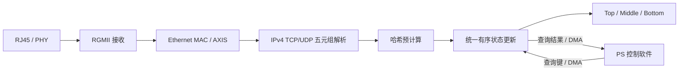

# 系统架构与数据通路

## 1. 总体思路

F21C 将网络报文解析与流级统计处理映射到 Zynq-7020 的可编程逻辑侧（PL），由处理系统（PS）负责配置、查询和结果读取。项目采用已有 Funnel-Sketch 的 Top / Middle / Bottom 分层状态组织思想，重点探索其 FPGA 结构化实现和持续输入条件下的任务协同。

## 2. 接收与统计路径

- **解析：** 从适用的 IPv4 TCP/UDP 报文中提取源 IP、目的 IP、源端口、目的端口和协议号。载荷不是流标识的组成部分。
- **统计：** 分层状态设计在有限的片上存储空间中兼顾大量低频流与较高频流的计数需求。
- **任务组织：** 解析、哈希预处理和统计后端分成三个 HLS 任务，以 FIFO 连接，减少不同计算环节之间的串行等待。
- **一致性：** UPDATE、QUERY、RESET 经单个有状态后端有序执行，以保持状态维护的确定性。
- **查询：** PS 侧发起指定流查询，PL 返回频次估计值，构成在线统计与读取闭环。

## 3. FPGA 映射要点

- 主逻辑的设计时钟记录为 **100 MHz**；以太网接口涉及独立时钟及跨时钟域处理。
- 流级测量包含以太网接入、协议字段提取、流键构造、哈希计算和计数状态访问。
- PS/PL 之间通过 AXI 控制与 DMA 数据通路交换查询信息。
- 片上统计状态采用 Top、Middle、Bottom 三级组织，逻辑总量约 **286 KiB**。

## 4. 工程价值与验证边界

该架构将分层流频次测量从算法形态转化为 FPGA 上可组织的数据处理和查询结构，可作为后续专用网络统计 IP 的工程研究基础。

上述内容说明系统设计与已有工程记录。仓库目前未分发工程配置或可执行源文件；具体测试适用版本、CDC 风险与复现状态见 [验证记录](VALIDATION_STATUS.md)。
